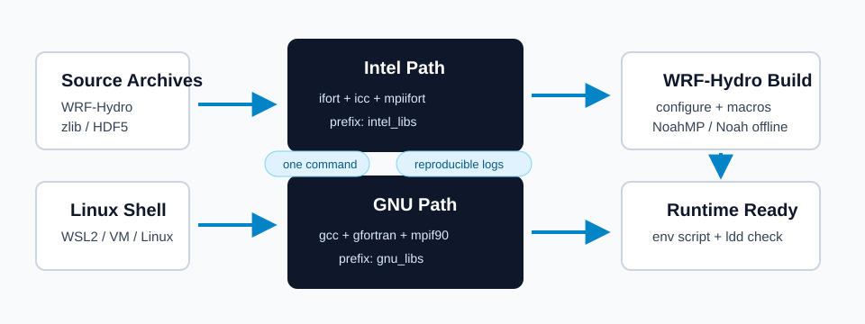

# easy_wrf-hydro_build [](https://github.com/XianlinChenCelian/easy_wrf-hydro_build)

这是一个用于部署 WRF-Hydro 离线模型的开源构建辅助工具。

[English](README_EN.md) | [安装流程](docs/bootstrap.md) | [常见问题](docs/troubleshooting.md) | [验证记录](docs/verified-builds.md)



`easy_wrf-hydro_build` 面向已经有 Linux、WSL2 或 Linux 虚拟机的用户，主要处理 WRF-Hydro 编译过程中容易出问题的依赖、编译器、MPI 和 NetCDF 环境。

当前版本只负责 **WRF-Hydro 离线模型**，不编译 WRF 和 WPS。

## Installation

从 GitHub 克隆或下载仓库后：

```bash
cd easy_wrf-hydro_build
python3 -m pip install -e .
ewhb --help
```

Ubuntu / WSL2 下建议先准备基础编译工具：

```bash
sudo apt-get update
sudo apt-get install -y build-essential gfortran g++ gcc make m4 perl csh tcsh \
  openmpi-bin libopenmpi-dev
```

如果是在实验室的空白 Windows + WSL2 电脑上复现，可参考 [空白 Windows / WSL2 环境说明](docs/blank-windows.md)。

## Usage

### 1. 准备源码压缩包

将下面这些文件放在同一个目录中，允许位于子目录：

```text
zlib-1.2.11.tar.gz
hdf5-1.12.0.tar.gz
netcdf-c-4.7.4.tar.gz
netcdf-fortran-4.5.3.tar.gz
wrf_hydro_nwm_public-5.1.2.tar.gz
```

如果需要自动运行 Croton, NY 示例，再加入：

```text
croton_NY_example_testcase.tar.gz
```

这些源码和测试数据不会随仓库分发，请从对应项目的官方渠道获取，并自行确认许可证和文件完整性。

### 2A. Intel 编译路线

适用于已经安装 Intel Fortran 和 Intel MPI 的环境。目前完整验证过的组合为：

```text
ifort + mpiifort
```

示例：

```bash
ewhb bootstrap \
  --compiler-family intel \
  --shared-dir /mnt/d/wrf-hydro-packages \
  --prefix ~/wrfhydro_build \
  --intel-home ~/intel/parallel_studio_xe_2018 \
  --run-example
```

构建完成后：

```bash
source ~/wrfhydro_build/wrf_hydro_intel_env.sh
```

### 2B. GNU 编译路线

示例：

```bash
ewhb bootstrap \
  --compiler-family gnu \
  --shared-dir /mnt/d/wrf-hydro-packages \
  --prefix ~/wrfhydro_build \
  --run-example
```

构建完成后：

```bash
source ~/wrfhydro_build/wrf_hydro_gnu_env.sh
```

## Features

- 从本地压缩包编译 zlib、HDF5、NetCDF-C 和 NetCDF-Fortran；
- Intel 和 GNU 编译环境使用独立依赖目录，减少库文件混用；
- 编译 WRF-Hydro NoahMP 或 Noah 离线可执行文件；
- 自动处理 Intel MPI 下 `mpif90` 与 `mpiifort` 的常见配置问题；
- 生成可重复 `source` 的运行环境脚本；
- 可选运行 Croton, NY 官方示例，检查从依赖编译到模型运行的完整流程。

## Documentation

- [完整安装与编译流程](docs/bootstrap.md)
- [Intel 编译器版本与分流](docs/intel-compiler-matrix.md)
- [常见错误与排查](docs/troubleshooting.md)
- [隔离闭环测试](docs/isolated-testing.md)
- [空白 Windows / WSL2 环境说明](docs/blank-windows.md)
- [项目路线图](docs/roadmap.md)

## Notes

1. **Intel 编译器**

   Intel 路线会查找 classic Parallel Studio 或 oneAPI 的环境脚本。当前最成熟的组合仍然是 `ifort + mpiifort`。只有 `ifx`、没有 `ifort` 的环境仍属于实验性支持。

2. **GNU 编译器**

   GNU 路线已经通过脚本生成、配置项和官方 `gfort` / `mpif90` 宏匹配检查，独立全编译还需要更多干净环境测试。

3. **仓库边界**

   本仓库只包含自动化脚本、文档、测试和 GitHub 页面素材，不分发 Intel 安装程序、许可证、WRF-Hydro 源码、第三方依赖源码或示例数据。

## Contributing

欢迎提交不同 Ubuntu、Intel oneAPI、GNU/OpenMPI 和 WRF-Hydro 版本的真实验证结果。

提交代码前请阅读 [CONTRIBUTING.md](CONTRIBUTING.md)。安全问题请参阅 [SECURITY.md](SECURITY.md)。

## License

本项目代码按 [MIT License](LICENSE) 发布。WRF-Hydro 及各第三方依赖仍遵循各自许可证。

## Contact

- **Author**: XianlinChen
- **Email**: chenxl@sehemodel.club
- **GitHub**: [@XianlinChenCelian](https://github.com/XianlinChenCelian)
- **Issues**: [GitHub Issues](https://github.com/XianlinChenCelian/easy_wrf-hydro_build/issues)

## Citation

如果在科研或教学工作中使用本项目，可通过仓库中的 [CITATION.cff](CITATION.cff) 获取推荐引用格式。
