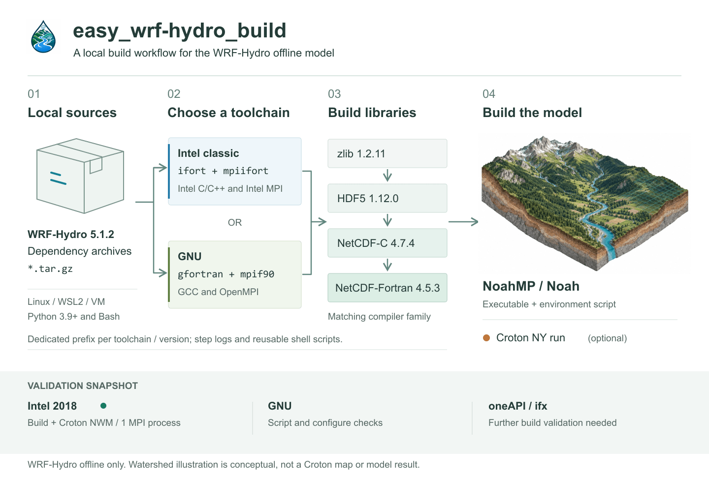

<p align="center"></p>

# easy_wrf-hydro_build

为已有 Linux 环境准备 WRF-Hydro 离线模型的编译与运行环境。

[](https://github.com/XianlinChenCelian/easy_wrf-hydro_build/actions/workflows/ci.yml)
[](pyproject.toml)
[](LICENSE)

[English](README_EN.md) · [快速开始](docs/quickstart.md) · [文档目录](docs/index.md) · [验证记录](docs/verified-builds.md)

WRF-Hydro 安装中比较费时间的，往往是编译器、MPI 和 NetCDF 之间的匹配。
这个项目把依赖编译、模型构建、环境脚本和示例运行整理为一套可以检查、重复执行的流程。
面向 Linux、WSL2 Ubuntu 和 Linux 虚拟机，当前基线为 **WRF-Hydro 5.1.2 离线模式**。



*流域插画为概念示意；编译流程与验证状态见下文。[查看高清图](docs/assets/figures/build-workflow.svg)*

## 当前支持

| 路线 | 编译器与 MPI | 验证状态 |
| --- | --- | --- |
| Intel classic | `ifort` / `icc` / `mpiifort` | Parallel Studio XE 2018 完成依赖编译、模型编译和 Croton NWM 单进程运行 |
| GNU | `gcc` / `gfortran` / OpenMPI `mpif90` | 脚本与配置分支已检查，干净环境完整运行待验证 |
| Intel oneAPI | 视安装版本而定 | 环境加载已适配；独立构建待验证，`ifx` 路线仍属实验性 |

CI 检查 Python 包、脚本和文档，**不代表所有编译器都完成了模型实测**。
具体组合见 [验证记录](docs/verified-builds.md) 和 [Intel 版本说明](docs/intel-compiler-matrix.md)。

## 安装

在 Linux 终端中安装 Python 3.9+、Git 和 `venv`。Ubuntu 用户可以先执行：

```bash
sudo apt-get update
sudo apt-get install -y python3 python3-venv python3-pip git
```

然后安装本工具：

```bash
git clone https://github.com/XianlinChenCelian/easy_wrf-hydro_build.git
cd easy_wrf-hydro_build
python3 -m venv .venv
source .venv/bin/activate
python -m pip install .
ewhb --help
```

系统编译工具和 MPI 按路线准备，见 [快速开始](docs/quickstart.md)。Intel 路线需要用户已有 Intel 编译器与 Intel MPI。

## 使用

先将 WRF-Hydro、zlib、HDF5、NetCDF-C 和 NetCDF-Fortran 源码包放在同一目录。
[源码清单](docs/source-archives.md) 列出了基线版本、官方获取入口和可选的 Croton 示例数据。

**Intel**，将 `--intel-home` 改为实际的编译器安装目录：

```bash
ewhb bootstrap --compiler-family intel \
  --shared-dir ~/wrf-hydro-packages \
  --prefix ~/wrfhydro-intel \
  --intel-home ~/intel/parallel_studio_xe_2018 \
  --jobs 4
source ~/wrfhydro-intel/wrf_hydro_intel_env.sh
```

**GNU**，使用系统安装的 GCC、GFortran 和 OpenMPI：

```bash
ewhb bootstrap --compiler-family gnu \
  --shared-dir ~/wrf-hydro-packages \
  --prefix ~/wrfhydro-gnu \
  --jobs 4
source ~/wrfhydro-gnu/wrf_hydro_gnu_env.sh
```

加入 `--dry-run` 可先生成脚本而不执行编译；准备好匹配版本的示例数据后，加入 `--run-example` 可运行 Croton NWM 示例。
不同路线或版本应使用**不同的 `--prefix`**，避免重用旧源码、日志和完成标记。

## 文档

| 你要做什么 | 入口 |
| --- | --- |
| 第一次从零编译 | [快速开始](docs/quickstart.md) |
| 准备依赖源码和示例数据 | [源码清单](docs/source-archives.md) |
| 查看完整构建流程和产物 | [构建说明](docs/bootstrap.md) |
| 使用现有 NetCDF / 调整编译选项 | [命令参考](docs/cli.md) |
| 直接运行一份命令示例 | [examples](examples/README.md) |
| 排查错误或验证新电脑 | [故障排查](docs/troubleshooting.md) · [隔离测试](docs/isolated-testing.md) |
| 了解代码放在哪里 | [仓库结构](docs/repository-layout.md) |

## 项目范围

本项目构建 WRF-Hydro 离线 NoahMP / Noah 可执行文件，生成运行环境脚本，可选运行官方示例。
WRF/WPS 编译、自定义流域预处理、率定及科学结果分析不在当前范围内。
第三方源码、数据、Intel 安装程序与许可证由用户自行准备，仓库不随包分发。

## 参与和引用

欢迎通过 [Issues](https://github.com/XianlinChenCelian/easy_wrf-hydro_build/issues) 提交错误或真实编译记录。
代码贡献见 [CONTRIBUTING.md](CONTRIBUTING.md)，后续计划见 [Roadmap](docs/roadmap.md)，版本变更见 [CHANGELOG.md](CHANGELOG.md)。

项目使用 [MIT License](LICENSE)。科研引用信息见 [CITATION.cff](CITATION.cff)；WRF-Hydro 和各依赖请分别遵循其许可证与引用要求。
页面组织参考了 [easy_vic_build](https://github.com/XudongZhengSteven/easy_vic_build) 和 [HydroMT](https://github.com/Deltares/hydromt)，本项目由作者独立维护。

**Author**: XianlinChen · **Email**: [chenxl@sehemodel.club](mailto:chenxl@sehemodel.club)
