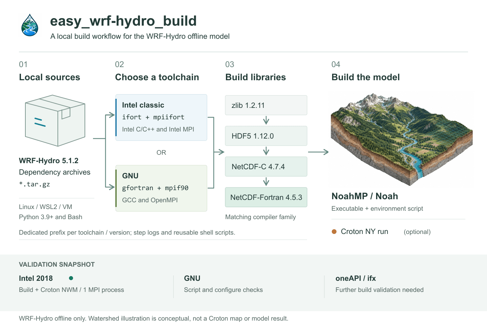

<p align="center"></p>

# easy_wrf-hydro_build

Build and prepare a WRF-Hydro offline environment on an existing Linux system.

[](https://github.com/XianlinChenCelian/easy_wrf-hydro_build/actions/workflows/ci.yml)
[](pyproject.toml)
[](LICENSE)

[中文](README.md) · [Build guide](docs/bootstrap.md) · [Documentation](docs/index.md) · [Verified builds](docs/verified-builds.md)

Matching compilers, MPI wrappers and NetCDF libraries is often the time-consuming part of a WRF-Hydro installation.
This tool brings dependency builds, model compilation, environment scripts and an optional example run into an inspectable, repeatable workflow.
It targets Linux, WSL2 Ubuntu and Linux VMs, with offline releases for WRF-Hydro **5.1.2, 5.2.0 and 5.4.0**.



*The watershed is a conceptual illustration, not a simulation result. [High-resolution figure](docs/assets/figures/build-workflow.svg)*

## Current Support

| Route | Compiler and MPI | Evidence |
| --- | --- | --- |
| Intel classic | `ifort` / `icc` / `mpiifort` | Parallel Studio XE 2018: dependencies, model build and single-process Croton NWM run completed |
| GNU | `gcc` / `gfortran` / OpenMPI `mpif90` | All three releases built and ran Croton on native Linux x86_64 compute nodes |
| Intel oneAPI | Depends on installed components | 5.4.0 built and ran Croton with site oneAPI 2021.3 `ifort`; `ifx` is a preview |

CI checks the Python package, scripts and documentation. **It is not a full WRF-Hydro compiler matrix.**
See [verified builds](docs/verified-builds.md) and the [Intel compiler matrix](docs/intel-compiler-matrix.md).

## Select a system, compiler and model version

Use the [release matrix](docs/release-bundles.md) to select a version. On a cluster, load the site compiler and MPI modules and pass `--site-toolchain` to the Intel recipe. On personal x86_64 Linux or WSL2, follow the [oneAPI installation guide](docs/oneapi-install.md) for a user-local toolchain. The [Intel matrix](docs/intel-compiler-matrix.md) records platform limits and validation.

## Installation

Use a Linux terminal with Python 3.9+, Git and `venv`. On Ubuntu:

```bash
sudo apt-get update
sudo apt-get install -y python3 python3-venv python3-pip git
git clone https://github.com/XianlinChenCelian/easy_wrf-hydro_build.git
cd easy_wrf-hydro_build
python3 -m venv .venv
source .venv/bin/activate
python -m pip install .
ewhb --help
```

Install system build tools and MPI for your route as described in the [build guide](docs/bootstrap.md).
The Intel route requires an existing Intel compiler and Intel MPI installation.

## Usage

Place the WRF-Hydro, zlib, HDF5, NetCDF-C and NetCDF-Fortran source archives in one directory.
The [archive inventory](docs/source-archives.md) lists baseline versions, official sources and optional Croton data.

**Intel**, replacing `--intel-home` with your installation directory:

```bash
ewhb bootstrap --compiler-family intel \
  --shared-dir ~/wrf-hydro-packages \
  --prefix ~/wrfhydro-intel \
  --intel-home ~/intel/parallel_studio_xe_2018 \
  --jobs 4
source ~/wrfhydro-intel/wrf_hydro_intel_env.sh
```

**GNU**, with GCC, GFortran and OpenMPI installed:

```bash
ewhb bootstrap --compiler-family gnu \
  --shared-dir ~/wrf-hydro-packages \
  --prefix ~/wrfhydro-gnu \
  --jobs 4
source ~/wrfhydro-gnu/wrf_hydro_gnu_env.sh
```

Add `--dry-run` to generate the script without compiling. With matching example data available, add `--run-example` to run the Croton NWM case.
Use a **different `--prefix` for each route or version** to avoid reusing sources, logs and completion markers.

## Documentation

| Task | Guide |
| --- | --- |
| First installation | [Quickstart (Chinese)](docs/quickstart.md) · [Build guide (English)](docs/bootstrap.md) |
| Source archives and test data | [Archive inventory](docs/source-archives.md) |
| Existing dependencies or custom options | [CLI reference](docs/cli.md) |
| Runnable command examples | [examples](examples/README.md) |
| Failed builds or a new host | [Troubleshooting](docs/troubleshooting.md) · [Isolated testing](docs/isolated-testing.md) |
| Contributing code | [Repository layout](docs/repository-layout.md) · [Contributing](CONTRIBUTING.md) |

## Scope

The tool builds the WRF-Hydro offline NoahMP / Noah executable, writes its runtime environment and optionally runs an official example.
WRF/WPS compilation, custom-domain preprocessing, calibration and scientific analysis are outside the current scope.
Third-party source archives, datasets, Intel installers and licenses are supplied separately by the user.

## Contributing and Citation

Report issues and reproducible build results through [GitHub Issues](https://github.com/XianlinChenCelian/easy_wrf-hydro_build/issues).
See [CONTRIBUTING.md](CONTRIBUTING.md), the [roadmap](docs/roadmap.md) and [changelog](CHANGELOG.md).

This project uses the [MIT License](LICENSE). Citation metadata is in [CITATION.cff](CITATION.cff); cite and license WRF-Hydro and its dependencies separately as appropriate.
The documentation organization draws on [easy_vic_build](https://github.com/XudongZhengSteven/easy_vic_build) and [HydroMT](https://github.com/Deltares/hydromt). This is an independently maintained project.

**Author**: XianlinChen · **Email**: [chenxl@sehemodel.club](mailto:chenxl@sehemodel.club)
